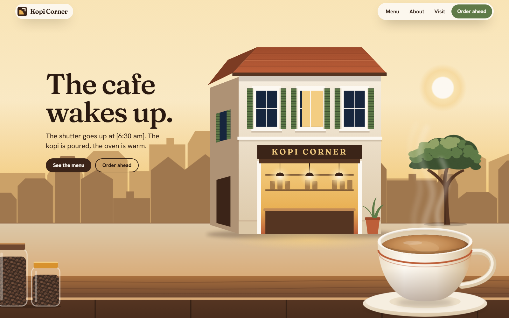

# Kopi Corner

A concept website for a fictional neighbourhood cafe in [Colombo], Sri Lanka.
Concept project designed by Depthwyn. Not a real business.

**The idea:** the cafe wakes up as you scroll. The site moves from the cool blue
of early morning to the warm amber of a busy cafe, the same way the cup fills from empty to full.
Then the cup's steam rises and turns into the chalk that writes the day's menu.



## Start

```bash
npm install
npm run dev        # http://localhost:4321
```

| Command | What it does |
| --- | --- |
| `npm run dev` | Local dev server |
| `npm run build` | Static build into `dist/` |
| `npm run preview` | Serve the build locally |
| `npm run check` | TypeScript and Astro type check |
| `npm run icons` | Re-render the PNG icons from `public/favicon.svg` |
| `npm run screenshot` | Re-capture `screenshot.png` (1600×1000) and `public/og.png` (1200×630) after a build. Needs `npx playwright install chromium` once. |

## Where things live

- **All words, prices, hours and contact details:** `src/content/site.ts`
- **Design tokens** (colours, fonts, type scale, spacing): `src/styles/global.css` (`@theme`)
- **Fonts:** `astro.config.mjs` (Astro font API, self-hosted at build time)
- **Scenes:** `src/components/` (one per scene: `HeroScene`, `ProofScene`, `OfferScene`, `EaseScene`, `InvitationScene`)
- **Motion:** `src/scripts/app.ts` (Lenis + GSAP lifecycle and anchors) and `src/scripts/scenes/*`
- **Photos:** drop them in `src/assets/photos/` and pass them to `PhotoSlot` (see the README in that folder)

Motion is turned off automatically for visitors who prefer reduced motion. They get a still,
fully readable version of every scene.

## Deploy to Cloudflare Pages

See [DEPLOY.md](./DEPLOY.md) for step-by-step instructions.

- Build command: `npm run build`
- Output directory: `dist`
- Set `site` in `astro.config.mjs` to the real domain first.

## The contact form

Create a form at formspree.io and put its endpoint in `business.formspreeEndpoint`
(`src/content/site.ts`). Until then, the form shows a "not connected yet" message.
